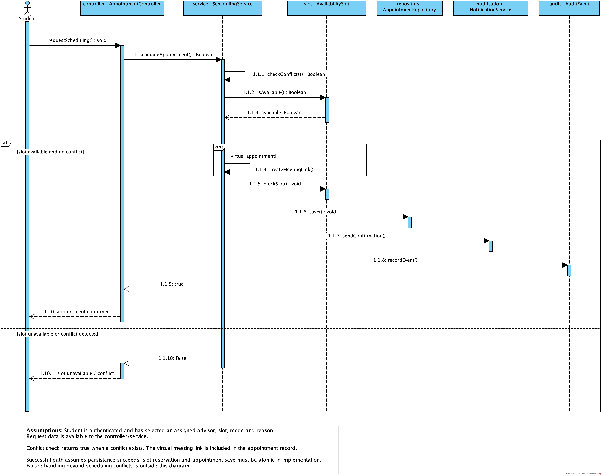

# University Academic Advising Appointment System

**Systems Analysis & Design | Georgia Gwinnett College**

## Project Overview

For my Systems Analysis and Design course, I used Visual Paradigm to design a proposed University Academic Advising Appointment System.

I approached the project by first considering the university's operational needs: who would use the system, what each person needed to accomplish, and how an appointment should move through the process. I then translated those requirements into UML diagrams that describe the proposed system's behavior and structure.

**Tools Used:** Visual Paradigm, UML  
**Technical Concepts:** Business Requirements Analysis, Process Modeling, Object-Oriented Design, Class Relationships, System Architecture, Software Development Life Cycle (SDLC)  
**Project Status:** System Design Phase — use case, class, and scheduling sequence diagrams completed; not a deployed application

## Business Problem

Academic advising involves coordination among students, faculty advisors, and department administrators. In a hypothetical university environment without a centralized scheduling process, students might have difficulty identifying available appointment times, advisors might have limited visibility into upcoming meetings, and administrators might struggle to review advising assignments or activity.

The business challenge I explored was how to organize these activities into a consistent process that supports students while giving advisors and administrators the information they need.

*This is a hypothetical scenario for coursework, not an assessment of an existing university system.*

## Business Requirements

I identified three main user groups and their responsibilities:

- **Students:** View assigned advisors and available time slots, request appointments, and manage existing bookings.
- **Faculty Advisors:** Manage availability, view scheduled appointments, and record advising notes.
- **Department Administrators:** Assign advisors to students and generate appointment reports.

I also considered requirements that affect more than one role, such as checking availability before booking, preventing scheduling conflicts, maintaining consistent appointment records, and supporting confirmations.

## Translating Business Requirements into System Design

### 1. Use Case Diagram — Defining User Needs

I began with a UML Use Case Diagram to identify the users and the actions they need to perform.

This helped me move from general business needs to specific system functions. For example, scheduling an appointment depends on being able to view available time slots. Mapping these interactions gave me a clearer picture of the system's scope before I designed its internal structure.

**UML Use Case Diagram**

### 2. Class Diagram — Organizing the System

Next, I created a UML Class Diagram to represent the proposed system's classes, attributes, operations, and relationships.

I started with a shared `User` class and used inheritance for `Student`, `Advisor`, and `Administrator`. I then modeled appointments, advisor assignments, availability slots, and advising notes.

One of the more challenging parts was deciding how the classes should relate to one another. I considered how students could have multiple appointments over time, how advisors could offer multiple time slots, and how an appointment should connect to a specific slot.

I also separated key responsibilities into supporting components:

- `AppointmentController` — Receives appointment requests.
- `SchedulingService` — Coordinates availability checks and scheduling operations.
- `AppointmentRepository` — Represents access to stored appointment records.
- `NotificationService` — Supports confirmations and reminders.
- `AuditEvent` — Represents records of system activity.

This helped me see how the business requirements translate into technical responsibilities rather than placing every function in one class.

**UML Class Diagram**

### 3. Sequence Diagram — Modeling the Appointment Workflow

I created a UML Sequence Diagram in Visual Paradigm to show how the system would process an academic advising appointment from the initial request to the final response.

The scheduling service checks for conflicts and verifies the selected slot's availability before allowing the booking to proceed. If the slot is available and no conflict exists, the system reserves the slot, saves the appointment, sends a confirmation, and records the scheduling activity. For virtual appointments, the design also includes an optional meeting link. If the slot is unavailable or a conflict is detected, the request is rejected without creating an appointment.

| Business requirement | Technical design |
| --- | --- |
| Prevent scheduling conflicts | `checkConflicts()`, `isAvailable()`, and `blockSlot()` |
| Support virtual advising | `createMeetingLink()` in an optional UML fragment |
| Maintain appointment records | `AppointmentRepository.save()` |
| Keep students informed | `NotificationService.sendConfirmation()` and a clear rejection response |
| Support accountability | `AuditEvent.recordEvent()` |

The diagram uses an alternative (`alt`) fragment to distinguish successful and unsuccessful requests and an optional (`opt`) fragment for virtual appointments. Only meeting link creation is conditional on the appointment mode; reserving the slot, saving the appointment, sending confirmation, and recording the event apply to both modes.

One important design consideration is that reserving the slot and saving the appointment must be atomic in a working implementation to prevent double bookings. The diagram assumes successful persistence and does not model other failure scenarios.

**UML Sequence Diagram**

## Expected Business Value

If implemented and tested, the proposed system could help a university:

- **Reduce scheduling conflicts** by checking slot availability before confirming appointments.
- **Improve access to advising** by making available times easier for students to identify.
- **Support advisor planning** through clearer schedule and availability information.
- **Improve administrative oversight** with advisor assignments and appointment reporting.
- **Maintain consistent records** of appointments and advising activity.

These are potential benefits of the design, not measured results from a live system.

## What I Learned

The biggest lesson for me was that system design starts with understanding the problem, not immediately building the application.

I had to think about the needs of different users, how information should be organized, and what should happen when an appointment is requested. Creating the UML diagrams helped me connect business requirements to object-oriented design concepts, including inheritance, class relationships, and separation of responsibilities.

It also reinforced why planning matters: decisions about workflows and data relationships are easier to examine and improve before development begins.

## Next Steps

With the three UML diagrams completed, I plan to use these designs as a possible foundation for a working application using Java or Python with a relational database.

Future development could include implementing scheduling and conflict checks, saving appointment records, and exploring reporting or analytics to help administrators understand advising activity and appointment trends.

---

**Shanteria Johnson**  
B.S. Information Technology — Data Science & Analytics  
Georgia Gwinnett College
