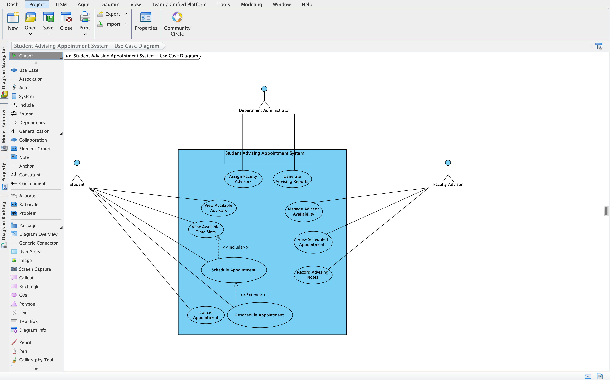
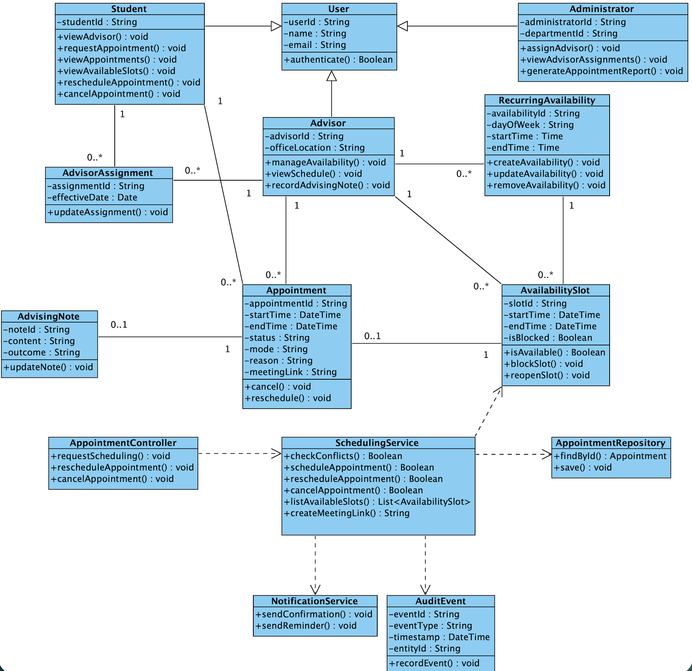

# University Academic Advising Appointment System

## Project Overview

For my Systems Analysis and Design course at Georgia Gwinnett College, I used Visual Paradigm to design a University Academic Advising Appointment System.

The project focuses on creating a more organized way for students to schedule appointments with academic advisors while allowing advisors to manage their availability and administrators to oversee advising assignments.

My goal was to understand how to take system requirements and turn them into a technical design before moving into development.

**Tools Used:** Visual Paradigm, UML  
**Technical Concepts:** Requirements Analysis, Object-Oriented Design, Class Relationships, System Architecture, Software Development Life Cycle (SDLC)  
**Project Status:** System Design Phase

## Design Process

### 1. Identifying Users and System Requirements

I started with a UML Use Case Diagram to identify the different users and the functions they would need.

The system includes three main roles:

- **Students:** View advisors and available time slots, schedule appointments, and manage existing appointments.
- **Faculty Advisors:** Manage availability, view scheduled appointments, and record advising notes.
- **Department Administrators:** Assign advisors and generate advising reports.

I mapped out the actions for each role and used UML relationships to show how certain functions connect. For example, scheduling an appointment includes viewing available time slots.

This was my starting point for understanding the system's requirements and making sure the design accounted for each user's responsibilities.

**UML Use Case Diagram**

### 2. Designing the System Structure

Next, I created a UML Class Diagram to show how the system would be organized.

I started with a `User` class containing shared information such as name, email, and authentication. From there, I created the `Student`, `Advisor`, and `Administrator` classes using inheritance.

I then added classes to manage appointments, advisor assignments, availability slots, and advising notes.

One of the more challenging parts was defining the relationships between classes. I had to consider how many appointments a student could schedule, how advisors would manage multiple time slots, and how appointments would connect to available slots.

I also included supporting components such as:

- `AppointmentController` — Handles appointment requests.
- `SchedulingService` — Manages scheduling operations and availability checks.
- `AppointmentRepository` — Represents how appointment records would be accessed and saved.
- `NotificationService` — Supports appointment confirmations and reminders.
- `AuditEvent` — Represents records of system activity.

Separating these responsibilities helped me better understand how the different parts of an application could work together without putting everything into one class.

**UML Class Diagram**

### 3. Modeling the Appointment Scheduling Process

*Sequence diagram documentation coming next.*

## What I Learned

This project gave me a better understanding of how system design connects business requirements to technical solutions.

The biggest takeaway for me was learning to think beyond individual features and consider how the entire system would work together.

Working with UML also helped me practice object-oriented design concepts, particularly inheritance, class relationships, and separation of responsibilities.

## Next Steps

I plan to use these designs as the foundation for building a working application using Java or Python with a relational database.

My next goal is to implement the appointment scheduling process, including checking availability, saving appointments, and preventing scheduling conflicts.

As the project develops, I'd also like to explore reporting and analytics features that could help administrators understand advising activity and appointment trends.

---

**Shanteria Johnson**  
B.S. Information Technology — Data Science & Analytics  
Georgia Gwinnett College
